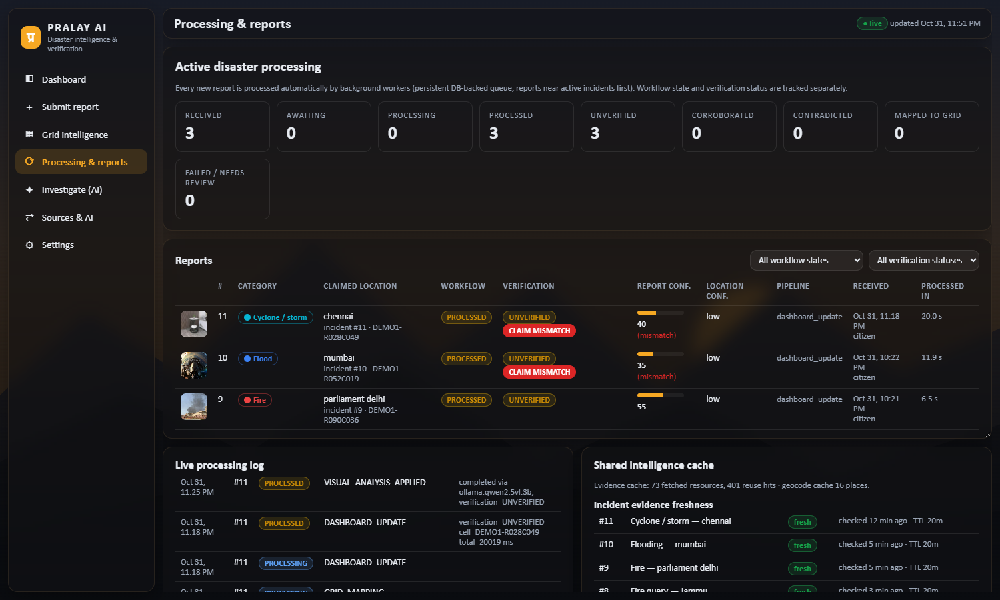
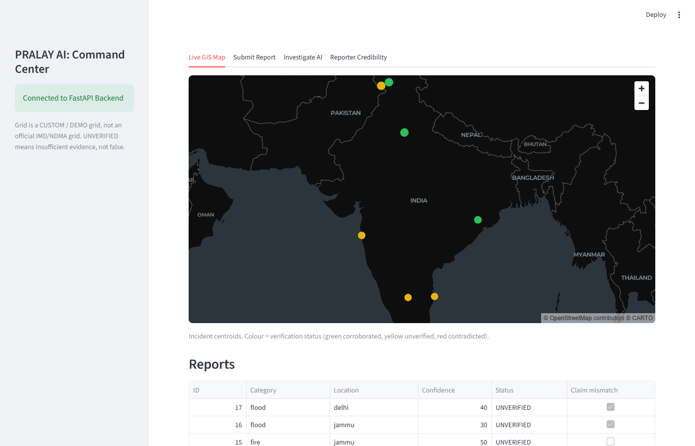

# PRALAY AI: Crowdsourced Disaster Intelligence & Verification

GRAVITON 2026 · Problem Statement #06 (Crowdsourced Extreme Weather Verification & GIS De-Duplicator)

## Project Overview
PRALAY AI collects crowdsourced disaster reports (photos, video, text) and automatically checks them. It looks for recycled or duplicate media and checks the image against the claim with a local vision model. It also verifies location and time, groups related reports into incidents, and weighs them against independent public sources: IMD, NDMA SACHET, news and weather. Every status describes the available evidence: **UNVERIFIED means insufficient evidence, not false**, and the system never declares an image authentic.

Full technical write-up: [ARCHITECTURE_EVALUATION.md](ARCHITECTURE_EVALUATION.md) · Older detailed documentation: [docs/README_DETAILED.md](docs/README_DETAILED.md)

## Screenshots
| Processing & reports: automatic **CLAIM MISMATCH** detection | Streamlit Command Center |
|---|---|
|  |  |

## Architecture
- **Backend:** Python FastAPI on `127.0.0.1:8000`, with background workers on a database-backed queue (leases, retries).
- **Database:** SQLite in WAL mode at `backend/data/pralay.db`, created automatically.
- **Local AI:** Ollama with `qwen2.5vl:3b`, running on your machine; images never leave it. Analysis is deferred, about 2–3 minutes per image on a CPU.
- **Frontend:** React, Vite and Leaflet. It's built once and served by the backend.
- **Alternative UI:** a Streamlit "Command Center" (`streamlit_app.py`) on `127.0.0.1:8501` that uses the same API.
- **Communication:** REST/JSON only; the UI polls a change counter. There are no WebSockets.

## Prerequisites
- Windows 10/11 with PowerShell. The scripts are written for Windows.
- **Python 3.11+**
- **Node.js 18+**, used to build the UI.
- **Ollama** with the vision model: install from https://ollama.com, then run `ollama pull qwen2.5vl:3b`. Optional, but without it image checks show "unavailable".
- About 8 GB of RAM is recommended for the vision model.

## Setup Instructions (Windows)
1. Clone the repository:
   ```powershell
   git clone https://github.com/Kanhaiya-26/Pralay-AI.git
   cd Pralay-AI
   ```
2. Install Ollama and pull the model: `ollama pull qwen2.5vl:3b`
3. *(Optional)* Create your config: `copy backend\.env.example backend\.env`, then edit it. If you skip this, `start.ps1` creates a working `backend\.env`. API keys are optional; see below.
4. First start. This creates `backend\.venv`, installs `backend\requirements.txt`, builds the UI and starts the server:
   ```powershell
   .\start.ps1
   ```
   If scripts are blocked: `powershell -ExecutionPolicy Bypass -File .\start.ps1`
5. Open http://127.0.0.1:8000
6. *(Optional)* Load first-run demo data: 3 synthetic reports from "Demo Reporter A", labelled DEMO.
   ```powershell
   backend\.venv\Scripts\python.exe backend\scripts\seed_first_run.py
   ```

## Environment Variables
All of these go in `backend\.env`; that's the only file the backend reads. A template is in [`backend/.env.example`](backend/.env.example). Never commit real values.

| Variable | Required? | Purpose |
|---|---|---|
| `VISION_PROVIDER`, `OLLAMA_URL`, `OLLAMA_MODEL`, `VISION_MODE` | set by `start.ps1` | Local vision AI (`ollama`, `http://127.0.0.1:11434`, `qwen2.5vl:3b`, `deferred`) |
| `OLLAMA_KEEP_ALIVE` | optional | How long the model stays loaded (e.g. `30m`) |
| `NASA_FIRMS_MAP_KEY` | optional | NASA FIRMS active-fire data (free key) |
| `OPENROUTER_API_KEY`, `OPENROUTER_MODELS` | optional | Rewords chat answers with free models only |
| `NASA_EARTHDATA_TOKEN` | not used yet | Placeholder; the IMERG adapter expects a username and password |
| `IP_BAN_STRIKES`, `IP_BAN_HOURS` | optional | 3-strike anti-spam ban (defaults 3 and 24). Use `IP_BAN_STRIKES=0` on a single demo laptop |
| `EXTERNAL_LOOKUPS`, `MAX_UPLOAD_MB`, `GRID_*`, `CLUSTER_*` | optional | See comments in `.env.example` |

The app works with **no API keys at all**. The IMD, SACHET, Google News, GDELT and Open-Meteo sources are public.

## How to Run
| What | Command | URL |
|---|---|---|
| Backend + built UI | `.\start.ps1` (stop: `.\stop.ps1`) | http://127.0.0.1:8000 |
| Frontend dev server (hot reload) | `cd frontend; npm install; npm run dev` | http://localhost:5173 (forwards API calls to :8000) |
| Streamlit Command Center | `backend\.venv\Scripts\streamlit.exe run streamlit_app.py --server.address 127.0.0.1` | http://localhost:8501 |

The backend must be running for the frontend dev server and Streamlit to work. Logs are in `logs\`.

## Test Suite
```powershell
backend\.venv\Scripts\python.exe backend\scripts\run_tests.py --suite all
```
Every suite starts an **isolated server** on port 8001, with a temporary data folder and synthetic fixtures, so your database is never touched.

| Suite | Flag | Last result |
|---|---|---|
| Full regression | `--suite all` | 154/154 (core end-to-end, extended, restart, worker, vision-adapter) |
| Core end-to-end | `--suite e2e_test.py` | 42/42 |
| Security | `--suite security` | 24/24 |
| Image claim mismatch | `--suite media-mismatch` | 11/11 |
| Anti-spam ban | `--suite ip-ban` | 12/12 |
| IMD RSS parser | `backend\.venv\Scripts\python.exe backend\scripts\unit_imd_rss.py` | 12/12 |

The vision tests use a protocol stub (`fake_ollama.py`) instead of the real model. `--suite vision-real` exercises the real Ollama model.

## Known Limitations
- **Confidence scores are heuristics**, built additively from a base of 50 with the factors shown. They are not calibrated probabilities.
- **The vision model is small and slow.** `qwen2.5vl:3b` on a CPU takes 2–3 minutes per image, one at a time, and can hallucinate. Visual AI is advisory, never a verdict.
- **OpenRouter free models are unreliable.** They often return 403, 429 or an empty reply; the chat then falls back to its built-in answers. Any links in AI replies are limited to URLs the app supplied.
- **News checks are keyword-based.** For example, "exchange of fire" (gunfire) can pass as a fire. Google News RSS is a public feed, not a contracted API.
- **There's no login or authorisation.** The API binds to `127.0.0.1` only; it is not built to face the internet.
- **Reporter identity is free text**, so anyone can type any name. Credibility is derived from that name's report outcomes.
- **The anti-spam ban can be evaded.** The device fingerprint is generated in the browser and can be changed, and IPs are shared behind NAT. Every local user is `127.0.0.1`. Also, a claim mismatch is not proof of fakery.
- **Only two foreign keys are declared** in the database (reports → incidents, media → reports). Other references are maintained by the application code.
- **IMD's official API products need credentials** (HTTP 401). Only IMD's public GeoServer and RSS feeds are used.
- **NASA FIRMS data isn't shown on the map yet.**
- **The disaster grid is a custom 0.25° demo lattice**, not an official IMD/NDMA grid.
- **Raw feed payloads are stored unmodified** for provenance (HTML/XML in raw tables); display text is cleaned.
- **Known UI glitch:** a Leaflet "save" console error on some map teardowns.

## License
MIT. See [LICENSE](LICENSE).
